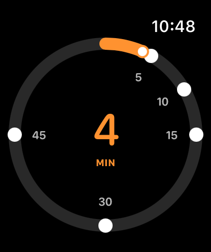
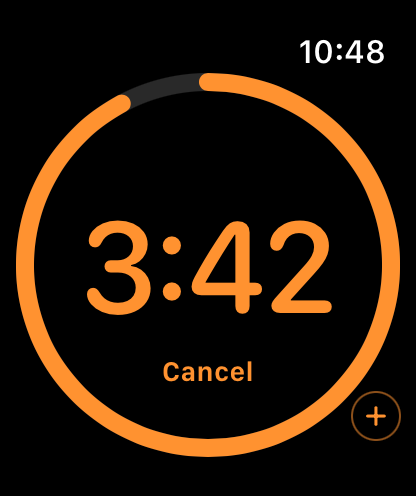
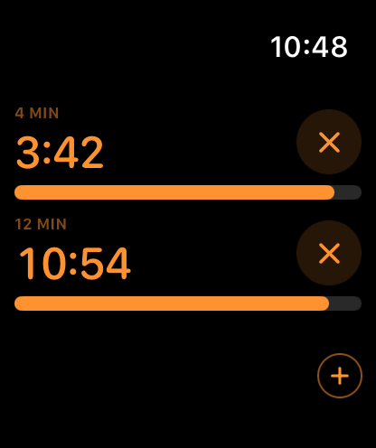
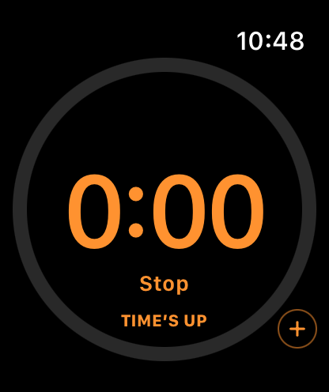

# Dial Timer

A visual timer for Apple Watch. Choose a duration on the dial, follow a large countdown, and keep several timers running at once.

Dial Timer runs directly on your watch, with no iPhone companion app or account required. Choose any whole-minute duration from **1 to 60 minutes**.

| Choose a duration | Watch the countdown | Run multiple timers |
| :---: | :---: | :---: |
|  |  |  |

*Screenshots from the Apple Watch Series 11 (46mm) simulator running watchOS 27.0. Timers shown use sample data.*

## Start a timer

1. Open Dial Timer on your watch.
2. **Tap the number** to start your saved preset. The initial preset is four minutes.
3. To choose another duration, **drag around the ring** clockwise from the top. **Release to start** the selected timer immediately.
4. To change your saved preset, **touch and hold the center**, choose a duration, and tap **Done**. Then tap the number to start it.

The ring starts full and shrinks as time passes. The countdown stays centered and readable. Tap **Cancel** to stop a running timer.

### Example: a four-minute tea timer

Open the app and tap **4**. You will see a `4:00` countdown inside the ring. Press the **Digital Crown** to leave the app and return through the watch’s system navigation. When the timer finishes, use **Stop** in the app or notification to acknowledge it and clear the remaining reminders.

## Add another timer

Tap the small **+** button at the lower right while a timer is running. The duration dial opens again; choose another duration and release to start it. The **back arrow** returns to your existing timers without adding one.

With two or more timers, the display changes to a scrolling list of countdowns and progress bars. Each timer has its own **×** control to cancel it, or a **Stop** control when it finishes. Removing all but one timer brings back the single ring.

### Example: tea and pasta

Start a **12-minute** timer for pasta. Tap **+**, drag the dial to **4 minutes**, and release to start a tea timer. Both countdowns now appear as separate bars. Stopping the tea timer leaves the pasta timer running.

Timers and your saved preset remain on the watch when you close and reopen the app. Reopening the app calculates the remaining time from each saved deadline.

## Completion alerts



Allow notifications when prompted so the watch can alert you after you leave the app.

- **While the app is active:** haptics repeat with increasing cadence until you stop the completed timer.
- **After leaving the app:** a notification is scheduled at expiry, followed by another every **10 seconds for up to two minutes**.
- **Tap Stop:** the timer is removed, and its remaining reminders and delivered notifications are cleared. Simply dismissing a notification does not stop the timer’s reminder batch.

There is a shared notification budget. Up to **four simultaneous timers** receive the full two-minute batch; larger sets get fewer follow-ups so every timer retains its initial alert. The app supports up to 32 stored timers, including completed timers awaiting dismissal.

watchOS controls notification delivery, sound, and haptic strength. Focus and notification settings may affect alerts. These reminders are a finite notification batch, and do not reproduce the built-in Timers app’s continuous background buzzing. Physical haptics and wrist delivery must be checked on an actual watch; simulator screenshots do not demonstrate them.

If an alert is missing, check that Dial Timer notifications are enabled and review the watch’s Focus and sound/haptic settings. You can reopen the app to see whether the timer has completed and tap **Stop**.

## Open from your watch face

Dial Timer includes an icon-only stopwatch complication for **circular, rectangular, and inline** slots on compatible watch faces.

1. Touch and hold the watch face, then tap **Edit**.
2. Select a complication slot and choose **Dial Timer**.
3. Tap the stopwatch icon to open the app.

The complication is a launcher; it does not show a live countdown. Use the **Digital Crown** to leave the app. The in-app back arrow only returns from the add-timer dial to existing timers; watchOS does not expose a public API for a button that returns directly to the watch face.

## Build and install

This repository contains the source project. An App Store or TestFlight download link is not currently provided.

### Requirements

- An Apple Watch running **watchOS 11 or later**, or a compatible watch simulator.
- A Mac with **Xcode**, a watchOS SDK, and **Swift 6** support. For simulator testing, install a compatible watchOS simulator runtime in Xcode.
- An Apple developer account configured in Xcode for installation on a physical watch.

### Run in the simulator

Download or clone this repository, then open **DialTimer.xcodeproj** in Xcode. Select the **DialTimer** scheme, choose a watch simulator, and run.

For a simulator build from Terminal:

```sh
xcodebuild -project DialTimer.xcodeproj -scheme DialTimer \
  -configuration Debug -destination 'generic/platform=watchOS Simulator' \
  -derivedDataPath /tmp/dial-timer-simulator CODE_SIGNING_ALLOWED=NO build
```

### Install on your watch

1. Add your Apple developer account in Xcode’s account settings.
2. Copy the signing template to the ignored local configuration:

   ```sh
   cp Config/Signing.local.xcconfig.example Config/Signing.local.xcconfig
   ```

3. Edit **Config/Signing.local.xcconfig** with your Apple development team ID and a unique bundle prefix, for example:

   ```xcconfig
   DEVELOPMENT_TEAM = YOUR_TEAM_ID
   DIAL_TIMER_BUNDLE_PREFIX = com.example.yourhandle
   ```

   Both targets inherit these settings. The app identifier becomes `com.example.yourhandle.dialtimer`; the complication uses `com.example.yourhandle.dialtimer.complication`. Keep your own team and identifiers in this ignored file rather than the shared project.
4. Pair and unlock your watch, select it as Xcode’s run destination, and run the **DialTimer** scheme. Complete any device registration or Developer Mode setup requested by Xcode.
5. Allow notifications on the watch when prompted.

### Project generation

The generated Xcode project is included, so **XcodeGen is optional** for building. Shared defaults live in **project.yml** and **Config/Signing.xcconfig**. Your ignored **Config/Signing.local.xcconfig** overrides signing settings without changing tracked files and survives project regeneration. To regenerate, run:

```sh
xcodegen generate
```

## Development and verification

| Path | Purpose |
| --- | --- |
| `Watch/DialTimerApp.swift` | SwiftUI screens, notification scheduling, and foreground haptics |
| `Watch/TimerState.swift` | Saved countdowns, repeat-notification planning, and haptic cadence |
| `Widgets/TimerComplication.swift` | Watch-face launcher complication |
| `Tests/TimerStateTests.swift` | Foundation-based behavior checks |
| `project.yml` | XcodeGen project definition |
| `Config/Signing.xcconfig` | Public signing defaults and optional local override |
| `Config/Signing.local.xcconfig.example` | Template for your ignored signing settings |

Run the behavior checks on macOS:

```sh
swiftc Watch/TimerState.swift Tests/TimerStateTests.swift -o /tmp/dial-timer-tests
/tmp/dial-timer-tests
```

The checks cover independent deadlines, cancellation, formatting, persistence, migration, foreground alert cadence, repeat-notification spacing, Stop identifiers, shared notification capacity, and relaunch windows. Current screenshots cover selection, a running timer, multiple timers, and completion. Gesture ergonomics, notification delivery, haptics, and complication appearance need testing on a physical watch.

Apple documents the relevant platform behavior in [local watchOS notifications](https://developer.apple.com/documentation/watchos-apps/enabling-and-receiving-notifications) and [extended runtime sessions](https://developer.apple.com/documentation/watchkit/using-extended-runtime-sessions).

## Privacy

Dial Timer does not require an account or a server. Timer deadlines and the saved preset are stored locally in the app’s preferences. Completion alerts are scheduled locally through watchOS. The source project contains no analytics or advertising SDKs.

## License

A license has not yet been selected for this source snapshot.
